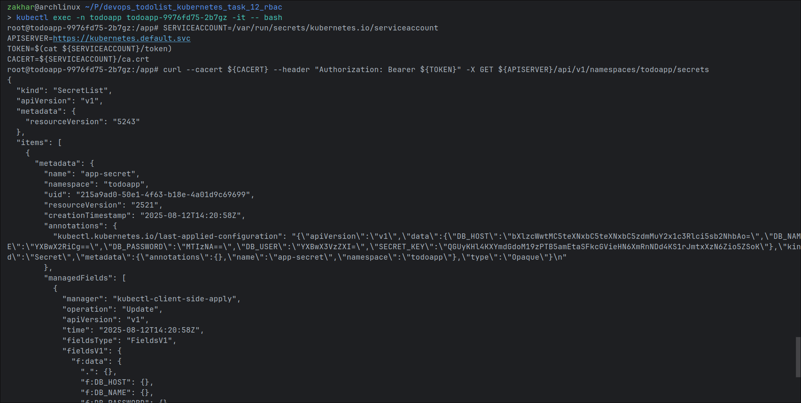

# Validation Instructions

This document provides step-by-step instructions to validate the RBAC configuration and secret listing functionality in the TodoApp Kubernetes deployment.

## Prerequisites

- `kind` installed on your system
- `kubectl` installed and configured
- Docker running

## Infrastructure Setup

Before validating the RBAC configuration, you need to set up the infrastructure:

### 1. Create Kind Cluster

Create a kind cluster using the provided cluster configuration:

```bash
kind create cluster --config cluster.yml
```

### 2. Deploy Application Infrastructure

Run the bootstrap script to deploy all necessary components:

```bash
./bootstrap.sh
```

This script will:
- Deploy MySQL database with ConfigMap, Secret, Service, and StatefulSet
- Deploy TodoApp with PV, PVC, Secret, ConfigMap, Services, HPA, and Deployment
- Apply RBAC configuration (ServiceAccount, Role, RoleBinding)
- Install Ingress Controller

### 3. Wait for Pods to be Ready

Wait for all pods to be running before proceeding with validation:

```bash
# Check MySQL pod
kubectl get pods -n mysql

# Check TodoApp pod
kubectl get pods -n todoapp
```

## Validation Steps

### 1. Verify RBAC Resources

Check that all RBAC components are created:

```bash
# Verify ServiceAccount
kubectl get serviceaccount secrets-lister -n todoapp

# Verify Role
kubectl get role secrets-lister -n todoapp

# Verify RoleBinding
kubectl get rolebinding secrets-lister-binding -n todoapp
```

### 2. Verify Deployment Configuration

Confirm the deployment is using the correct ServiceAccount:

```bash
# Check deployment uses the ServiceAccount
kubectl get deployment todoapp -n todoapp -o jsonpath='{.spec.template.spec.serviceAccountName}'
```

Expected output: `secrets-lister`

### 3. Verify Pod is Running

```bash
# Get pod status
kubectl get pods -n todoapp -l app=todoapp

# Get pod name for further testing
export POD_NAME=$(kubectl get pods -n todoapp -l app=todoapp -o jsonpath='{.items[0].metadata.name}')
```

### 4. Test Secret Listing Permissions

First, enter the todoapp container:

```bash
# Enter the container
kubectl exec -it -n todoapp $POD_NAME -- /bin/bash
```

Once inside the container, execute the following commands to set up environment variables and test secret listing:

```bash
# Set up environment variables for Kubernetes API access
SERVICEACCOUNT=/var/run/secrets/kubernetes.io/serviceaccount
APISERVER=https://kubernetes.default.svc
TOKEN=$(cat ${SERVICEACCOUNT}/token)
CACERT=${SERVICEACCOUNT}/ca.crt

# Test listing secrets using Kubernetes API
curl --cacert ${CACERT} --header "Authorization: Bearer ${TOKEN}" -X GET ${APISERVER}/api/v1/namespaces/todoapp/secrets
```

**Expected Output:**

The curl command should return a JSON response containing the list of secrets in the todoapp namespace. You can see an example of the expected output in the screenshot below:



The output should show:
- A `SecretList` with `apiVersion: v1`
- An `items` array containing secret objects
- Each secret should have metadata including name, namespace, uid, and other properties
- The `app-secret` should be visible in the list

Exit the container when done:

```bash
exit
```

### 5. Alternative Testing Method

If curl is not available in the container, test permissions using kubectl:

```bash
# Test permissions using kubectl auth can-i
kubectl auth can-i list secrets --as=system:serviceaccount:todoapp:secrets-lister -n todoapp
kubectl auth can-i get secrets --as=system:serviceaccount:todoapp:secrets-lister -n todoapp
```

Expected output: `yes` for both commands

### 6. Verify Secret Access

Check that the pod can access the mounted secrets:

```bash
# Verify secret is mounted and accessible
kubectl exec -n todoapp $POD_NAME -- ls -la /app/secrets/

# Check environment variables from secrets
kubectl exec -n todoapp $POD_NAME -- env | grep -E "(SECRET_KEY|DB_)"
```

## Expected Results

1. All RBAC resources should be created successfully
2. Pod should be running with `secrets-lister` ServiceAccount
3. Curl command should return JSON response with secrets list
4. `kubectl auth can-i` commands should return `yes`
5. Secret files should be visible in `/app/secrets/` directory
6. Environment variables should be populated from secrets
