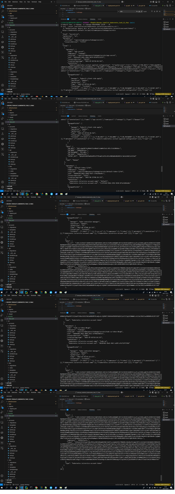

# Kubernetes Security: RBAC Implementation

## 📖 Project Overview
This project highlights a critical aspect of Kubernetes administration: security governance. It demonstrates the practical implementation of **Kubernetes Role-Based Access Control (RBAC)** to enforce the principle of least privilege, ensuring that application workloads only have the minimum permissions necessary to function.

## 🛠 Tech Stack & Tools
* **Container Orchestration:** Kubernetes (kind cluster)
* **Security & IAM:** Kubernetes RBAC (ServiceAccounts, Roles, RoleBindings)
* **API Interaction:** cURL

## ⚙️ Implementation Details
The security posture of the application was hardened through the following steps:
1. **ServiceAccount Provisioning:** Created a dedicated `ServiceAccount` specific to the application deployment, moving away from the insecure practice of using the `default` namespace account.
2. **Role Definition:** Configured a custom Kubernetes `Role` that explicitly grants read-only access (the ability to `list`) to Kubernetes `Secrets` within the specific namespace.
3. **RoleBinding:** Securely mapped the custom `Role` to the newly created `ServiceAccount` via a `RoleBinding`, bridging the identity with the permission set.
4. **Pod Integration:** Updated the application's Deployment manifest to run utilizing the customized `ServiceAccount`.

## 📸 Security Validation
To prove the RBAC configuration was successful, an API validation test was executed. A `curl` command was run directly from within the application pod, successfully authenticating against the Kubernetes API and listing the secrets based on the granted permissions.

<b>RBAC API Execution Test Screenshot</b> (Click to expand)

 

## 📝 Code Review & Approval
This security configuration has been rigorously reviewed by a Senior DevOps Engineer to ensure correct implementation of IAM policies within the cluster.

You can view the full discussion, implementation details, and final approval in the **[Pull Request #67](https://github.com/mate-academy/devops_todolist_kubernetes_task_12_rbac/pull/67)**.
